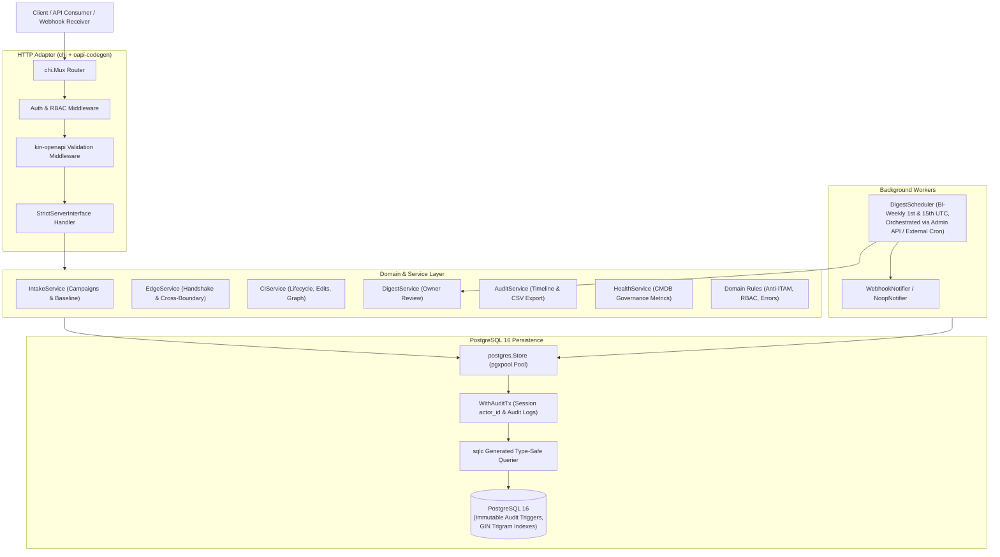

# Architecture & Technical Design

This document details the architectural patterns, security model, transaction handling, and layered design implemented in `etcms-backend`.

---

## 1. High-Level Architecture Diagram



---

## 2. Layered Hexagonal Structure

The repository adheres strictly to a clean ports-and-adapters (hexagonal) architecture:

### 1. HTTP Adapter ([`internal/adapters/http`](../internal/adapters/http))
- **Router:** Built with [`go-chi/chi/v5`](https://github.com/go-chi/chi) providing minimal overhead and idiomatic middleware chaining.
- **Contract-First Code Generation:** Compiled from [`api/openapi.yaml`](../api/openapi.yaml) via `oapi-codegen`. Generates strongly-typed request and response DTOs, query param parsers, and strict interfaces.
- **Global Ingress Middleware:** Mounts `RequestID`, `Recoverer`, `MaxBodySize(2MB)` ([`internal/adapters/http/middleware/max_body.go`](../internal/adapters/http/middleware/max_body.go)), `AntiITAM()` ([`internal/adapters/http/middleware/anti_itam.go`](../internal/adapters/http/middleware/anti_itam.go)), and `auth.Middleware` ([`internal/adapters/http/middleware/auth.go`](../internal/adapters/http/middleware/auth.go)).
- **Strict Server Implementation:** [`internal/adapters/http/handler/server.go`](../internal/adapters/http/handler/server.go) implements all generated strict interface methods, converting domain results directly into RFC 9457 Problem Details or 200/201 JSON responses.

### 2. Domain Layer ([`internal/domain`](../internal/domain))
- **Actor & RBAC:** Defines `Actor`, `Role` (`viewer`, `team_lead`, `platform_admin`), and multi-group membership verification methods (`BelongsToOwnerGroup`, `HasRole`).
- **Anti-ITAM Enforcement:** [`internal/adapters/http/middleware/anti_itam.go`](../internal/adapters/http/middleware/anti_itam.go) and [`internal/domain/itam.go`](../internal/domain/itam.go) inspect incoming JSON request bodies (`POST`, `PATCH`, `PUT`) at arbitrary recursive nesting depth to reject unapproved ITAM fields (`cost`, `purchase_cost`, `license_count`, `warranty_end`, `vendor`) with `HTTP 422 Unprocessable Entity`.
- **Domain Errors:** Strongly-typed errors for conflict detection (`ConflictError` with `DependentCIs`), schema validation (`ValidationError` with `NodeErrors`), and precondition conflicts (`ErrLockVersionMismatch`).

### 3. Service Layer ([`internal/service`](../internal/service))
- **`IntakeService`:** Manages intake campaign lifecycles, magic link hashing (SHA-256), optimistic draft auto-saves, and atomic multi-CI publishing.
- **`EdgeService`:** Manages post-baseline dependency creation, self-loop prevention, and cross-boundary handshake workflows (`confirm`, `flag-mismatch`, `reject`).
- **`CIService`:** Manages post-baseline CI lifecycles, trigram catalog search, detail aggregation, upward impact graph traversal, downward dependency traversal, and volatile-only verification stamping.
- **`DigestService`:** Fetches active calendar review items and handles one-click verification and retirement.
- **`AuditService`:** Exposes cursor-paginated timeline queries and streaming CSV/NDJSON exports protected against formula injection.
- **`HealthService`:** Computes real-time CMDB governance metrics (Freshness, Orphans, Pending Edges, Digest Completion).

### 4. Persistence Layer ([`internal/adapters/postgres`](../internal/adapters/postgres))
- **Connection Pool:** Uses `pgxpool.Pool` configured with health checks and statement caching.
- **Type-Safe Queries:** Hand-crafted, optimized SQL in [`sql/queries/*.sql`](../sql/queries) compiled to Go with `sqlc`.
- **Transactional Audit Wrapper (`WithAuditTx`):** Ensures that all mutating operations configure PostgreSQL session variable `etcms.actor_id` and append immutable audit log records atomically.

### 5. Worker Layer ([`internal/worker`](../internal/worker))
- **`DigestScheduler`:** Idempotent, calendar-anchored worker executing bi-weekly (1st and 15th of each month, 00:00 UTC) with distributed safety. Rather than maintaining an in-process ticker loop in `cmd/etcms-api/main.go`, the scheduler is designed for external orchestration (e.g. Kubernetes CronJob or Cloud Scheduler) calling `POST /api/v1/admin/digests/trigger` or running the standalone worker process.

---

## 3. Security & Authentication Architecture

### Dual-Mode Authentication Guard
The application implements strict environment-based authentication handling in [`internal/adapters/http/middleware/auth.go`](../internal/adapters/http/middleware/auth.go). Credential extraction proceeds in three prioritized stages:

1. **Development Auth Guard (`X-Dev-User-ID`):**
   - Active only when `APP_ENV` is `development` or `test` and `ALLOW_DEV_AUTH_HEADER=true`.
   - The middleware parses `X-Dev-User-ID: <uuid>`, calls `GetUserByID(ctx, devUserID)` and `GetUserOwnerGroupIDs(ctx, devUserID)` to authenticate the principal, enabling automated test execution across various user roles without mock token servers.
   - **Environment Safety Guard:** In production and staging (`APP_ENV != "development"` and `APP_ENV != "test"`), `X-Dev-User-ID` headers are **completely ignored**. If `ALLOW_DEV_AUTH_HEADER=true` is configured in production or staging, the server refuses to boot with a fatal startup error (`security violation: ALLOW_DEV_AUTH_HEADER=true is strictly prohibited in <env> environment`).

2. **Bearer Token Authentication (`Authorization: Bearer <uuid>`):**
   - Incoming requests provide `Authorization: Bearer <token>`.
   - The authenticator middleware extracts the token, resolves it as a user UUID via `GetUserByID(ctx, userID)`, and retrieves all associated owner group memberships from `user_owner_groups` via `GetUserOwnerGroupIDs(ctx, userID)`.
   - The resolved `domain.Actor` is injected into the request context via `ContextWithActor`.
   - If the header is missing or references an unknown user, subsequent endpoints guarded by `RequireAuth` return `HTTP 401 Unauthorized` with RFC 9457 Problem Details.

3. **Intake Magic Link Authentication (`X-Intake-Token`):**
   - Guided intake wizard routes accept a raw tokenized magic link via the path parameter (`/api/v1/intake/{token}`) or header (`X-Intake-Token: <token>`).
   - The raw token is hashed with SHA-256 (`token_hash`) and looked up in `intake_invitations`.
   - If found, unexpired (`expires_at > now()`), and not in `'expired'` status, the caller is authenticated as a synthetic `team_lead` Actor assigned to the invitation's `owner_group_id`.
   - Raw tokens are never logged or persisted in plain text.

### Domain RBAC Roles vs. Owner Group Membership
Authorization requires evaluating both the user's system role and their owner group memberships:

```
+------------------+-----------------------------------------------------------+
| Role             | Permissions & Constraints                                 |
+------------------+-----------------------------------------------------------+
| viewer           | - Read active CI catalog, search, and details             |
|                  | - Traverse graph (upward impact & downward dependencies)  |
|                  | - Report data-quality flags on CIs (POST .../flags)       |
|                  | - Export audit logs for member groups                     |
|                  | - STRICTLY READ-ONLY: Rejected with HTTP 403 Forbidden    |
|                  |   on CI creation (POST /cis), CI updates (PATCH /cis/{id}),|
|                  |   CI verification (POST .../verify), CI retirement        |
|                  |   (POST .../retire), edge creation (POST /edges),         |
|                  |   edge deletion (DELETE /edges/{id}), or edge handshakes  |
|                  |   (confirm, flag-mismatch, reject), even if the user      |
|                  |   belongs to the owner group.                             |
+------------------+-----------------------------------------------------------+
| team_lead        | - All viewer read permissions                             |
|                  | - Access guided intake wizard via magic link              |
|                  | - Create CIs for member groups (POST /cis)                |
|                  | - Update CIs owned by member groups (PATCH /cis/{id})     |
|                  | - Verify CIs owned by member groups (POST .../verify)     |
|                  | - Retire leaf CIs owned by member groups (POST .../retire)|
|                  | - Create / delete edges where caller belongs to source    |
|                  |   OR target CI owner group                                |
|                  | - Confirm / flag / reject incoming cross-boundary edges   |
|                  |   targeting member groups (target CI owner group member)  |
|                  | - Access active digest review for own group               |
|                  | - Export audit logs for own member group                  |
+------------------+-----------------------------------------------------------+
| platform_admin   | - Superuser access across all owner groups                |
|                  |   (BelongsToOwnerGroup returns true for any group ID)     |
|                  | - Launch decentralized intake campaigns                   |
|                  | - Force retire CIs with active dependents (force=true)    |
|                  | - Export global audit logs across all groups              |
|                  | - Manually trigger digest scheduler runs                  |
+------------------+-----------------------------------------------------------+
```

> [!IMPORTANT]
> **Group Membership Invariant:** For mutating operations (`CreateCI`, `UpdateCI`, `VerifyCI`, `RetireCI`), the caller must belong to the affected CI's owner group (`actor.BelongsToOwnerGroup(...)`) unless the caller is `platform_admin`. For edge handshakes (`ConfirmEdge`, `FlagMismatch`, `RejectEdge`), the caller must belong to the **target** CI's owner group. For edge creation and deletion, the caller must belong to either the **source** or **target** CI's owner group. Users with `role = viewer` are strictly prohibited from any mutating operation regardless of group membership.

---

## 4. Transactional Audit Wrapper (`WithAuditTx`)

Auditing in `etcms-backend` is enforced at the transaction boundary rather than as an asynchronous best-effort task:

```go
func (s *Store) WithAuditTx(ctx context.Context, actor domain.Actor, fn func(tx pgx.Tx, q *sqlcgen.Queries) error) error
```

### Execution Flow & Session Configuration:
1. Begins a database transaction `tx` via `pgxpool`.
2. Executes `SELECT set_config('etcms.actor_id', actor.ID.String(), true)` to attach the actor ID to the PostgreSQL transaction-local session. This is available for PostgreSQL session audit logs, triggers, and DBA tracing.
3. Invokes the domain business logic function `fn(tx, q)`.
4. Domain queries write one or more structured audit log records into `audit_logs` inside the same transaction via `q.CreateAuditLog(ctx, gen.CreateAuditLogParams{ActorID: actor.ID, ...})`.
   - *Note:* The `audit_logs.actor_id` column is populated **directly by application queries** passing `actor.ID`. It is not populated by a database trigger reading `current_setting('etcms.actor_id')`.
5. If `fn` succeeds, the transaction commits atomically. If `fn` returns an error, the entire transaction rolls back, leaving no orphaned state or audit logs.

---

## 5. Concurrency Control

### Optimistic Locking on Wizard Drafts
- The intake wizard endpoint `PATCH /api/v1/intake/{token}` requires an `If-Match: "<lock_version>"` header.
- The service verifies that the incoming version matches `intake_submissions.lock_version`.
- If matched, the draft updates and `lock_version` increments by 1.
- If mismatched, the server aborts with `HTTP 412 Precondition Failed`, preventing concurrent team leaders from overwriting drafts.

### Pessimistic Row Locking on Baseline Submission
- When `POST /api/v1/intake/{token}/submit` is called, the service acquires an exclusive row lock on the intake submission using `SELECT ... FROM intake_submissions s ... FOR UPDATE OF s`.
- **Idempotent Replay Handling:** If the submission is already in `'submitted'` or `'approved'` status, the service queries for the existing baseline via `GetBaselineByCampaignAndGroup`. If found, it returns the existing baseline with **`HTTP 200 OK`** (idempotent replay), while **`HTTP 201 Created`** is returned only upon initial publication. If the submission is approved/submitted but no baseline record exists, it returns `HTTP 409 Conflict`.
- Uses idempotency keys (`Idempotency-Key` header) to guarantee safe client re-submissions.
