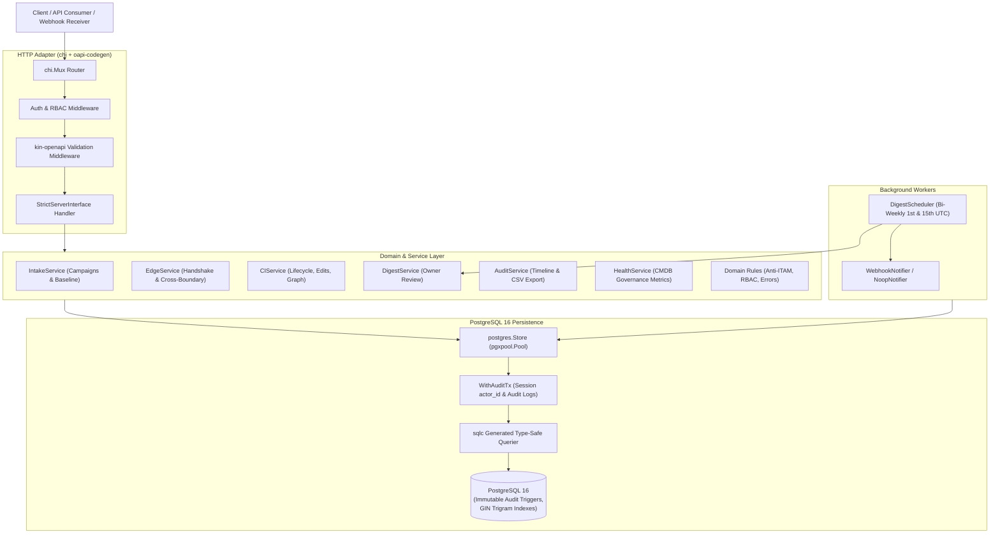

# Architecture & Technical Design

This document details the architectural patterns, security model, transaction handling, and layered design implemented in `etcms-backend`.

---

## 1. High-Level Architecture Diagram



---

## 2. Layered Hexagonal Structure

The repository adheres strictly to a clean ports-and-adapters (hexagonal) architecture:

### 1. HTTP Adapter ([`internal/adapters/http`](file:///home/nahom/Work/ET/etcms/etcms-backend/internal/adapters/http))
- **Router:** Built with [`go-chi/chi/v5`](https://github.com/go-chi/chi) providing minimal overhead and idiomatic middleware chaining.
- **Contract-First Code Generation:** Compiled from [`api/openapi.yaml`](file:///home/nahom/Work/ET/etcms/etcms-backend/api/openapi.yaml) via `oapi-codegen`. Generates strongly-typed request and response DTOs, query param parsers, and strict interfaces.
- **Strict Server Implementation:** [`internal/adapters/http/handler/server.go`](file:///home/nahom/Work/ET/etcms/etcms-backend/internal/adapters/http/handler/server.go) implements all generated strict interface methods, converting domain results directly into RFC 9457 Problem Details or 200/201 JSON responses.

### 2. Domain Layer ([`internal/domain`](file:///home/nahom/Work/ET/etcms/etcms-backend/internal/domain))
- **Actor & RBAC:** Defines `Actor`, `Role` (`viewer`, `team_lead`, `platform_admin`), and multi-group membership verification methods (`BelongsToOwnerGroup`, `HasRole`).
- **Anti-ITAM Enforcement:** [`internal/domain/itam.go`](file:///home/nahom/Work/ET/etcms/etcms-backend/internal/domain/itam.go) validates incoming JSON payloads to ensure prohibited asset management fields (`cost`, `purchase_cost`, `license_count`, `warranty_end`, `vendor`) never pollute the operational CMDB.
- **Domain Errors:** Strongly-typed errors for conflict detection (`ConflictError` with `DependentCIs`), schema validation (`ValidationError` with `NodeErrors`), and precondition conflicts (`ErrLockVersionMismatch`).

### 3. Service Layer ([`internal/service`](file:///home/nahom/Work/ET/etcms/etcms-backend/internal/service))
- **`IntakeService`:** Manages intake campaign lifecycles, magic link hashing (SHA-256), optimistic draft auto-saves, and atomic multi-CI publishing.
- **`EdgeService`:** Manages post-baseline dependency creation, self-loop prevention, and cross-boundary handshake workflows (`confirm`, `flag-mismatch`, `reject`).
- **`CIService`:** Manages post-baseline CI lifecycles, trigram catalog search, detail aggregation, upward impact graph traversal, downward dependency traversal, and volatile-only verification stamping.
- **`DigestService`:** Fetches active calendar review items and handles one-click verification and retirement.
- **`AuditService`:** Exposes cursor-paginated timeline queries and streaming CSV/NDJSON exports protected against formula injection.
- **`HealthService`:** Computes real-time CMDB governance metrics (Freshness, Orphans, Pending Edges, Digest Completion).

### 4. Persistence Layer ([`internal/adapters/postgres`](file:///home/nahom/Work/ET/etcms/etcms-backend/internal/adapters/postgres))
- **Connection Pool:** Uses `pgxpool.Pool` configured with health checks and statement caching.
- **Type-Safe Queries:** Hand-crafted, optimized SQL in [`sql/queries/*.sql`](file:///home/nahom/Work/ET/etcms/etcms-backend/sql/queries) compiled to Go with `sqlc`.
- **Transactional Audit Wrapper (`WithAuditTx`):** Ensures that all mutating operations configure PostgreSQL session variables and append immutable audit log records atomically.

### 5. Worker Layer ([`internal/worker`](file:///home/nahom/Work/ET/etcms/etcms-backend/internal/worker))
- **`DigestScheduler`:** Idempotent, calendar-anchored worker executing bi-weekly (1st and 15th of each month, 00:00 UTC) with distributed safety.

---

## 3. Security & Authentication Architecture

### Dual-Mode Authentication Guard
The application supports bearer tokens for production environments and an explicit development auth header for testing:

1. **Development Auth Guard:**
   - In `APP_ENV=development` or `APP_ENV=test`, the middleware parses `X-Dev-User-ID: <uuid>` to authenticate the principal.
   - **Production Safety Invariant:** If `APP_ENV` is set to `production` or `staging` and `ALLOW_DEV_AUTH_HEADER=true`, the server **refuses to boot** with a fatal error.
2. **Intake Token Authentication:**
   - Guided intake wizard routes accept a tokenized magic link hash (`/api/v1/intake/{token}`).
   - Tokens are hashed with SHA-256 prior to database storage. Raw tokens are never logged or persisted in plain text.
   - The token authenticates the caller as the team lead of the assigned `owner_group`.

### Domain RBAC Roles & Permissions
```
+------------------+-----------------------------------------------------------+
| Role             | Permissions                                               |
+------------------+-----------------------------------------------------------+
| viewer           | - Read active CI catalog and search                       |
|                  | - Traverse graph (upward impact & downward dependencies)  |
|                  | - Report data-quality flags on CIs                        |
+------------------+-----------------------------------------------------------+
| team_lead        | - All viewer permissions                                  |
|                  | - Access guided intake wizard via magic link              |
|                  | - Create / update CIs owned by member groups              |
|                  | - Verify CIs owned by member groups                       |
|                  | - Retire leaf CIs owned by member groups                  |
|                  | - Confirm / flag / reject incoming cross-boundary edges   |
|                  | - Access active digest review for own group               |
|                  | - Export audit logs for own group                         |
+------------------+-----------------------------------------------------------+
| platform_admin   | - Superuser access across all owner groups                |
|                  | - Launch decentralized intake campaigns                   |
|                  | - Force retire CIs with active dependents                 |
|                  | - Export global audit logs across all groups              |
|                  | - Manually trigger digest scheduler runs                  |
+------------------+-----------------------------------------------------------+
```

---

## 4. Transactional Audit Wrapper (`WithAuditTx`)

Auditing in `etcms-backend` is enforced at the transaction boundary rather than as an asynchronous best-effort task:

```go
func (s *Store) WithAuditTx(ctx context.Context, actor domain.Actor, fn func(tx pgx.Tx, q *sqlcgen.Queries) error) error
```

### Execution Flow:
1. Begins a database transaction `tx` via `pgxpool`.
2. Executes `SELECT set_config('etcms.actor_id', actor.ID.String(), true)` to associate the transaction session with the actor ID.
3. Invokes the domain business logic function `fn(tx, q)`.
4. Writes one or more structured audit log records into `audit_logs` inside the same transaction.
5. If `fn` succeeds, the transaction commits atomically. If `fn` returns an error, the entire transaction rolls back, leaving no orphaned state or audit logs.

---

## 5. Concurrency Control

### Optimistic Locking on Wizard Drafts
- The intake wizard endpoint `PATCH /api/v1/intake/{token}` requires an `If-Match: "<lock_version>"` header.
- The service verifies that the incoming version matches `intake_submissions.lock_version`.
- If matched, the draft updates and `lock_version` increments by 1.
- If mismatched, the server aborts with `HTTP 412 Precondition Failed`, preventing concurrent team leaders from overwriting drafts.

### Pessimistic Row Locking on Baseline Submission
- When `POST /api/v1/intake/{token}/submit` is called, the service acquires an exclusive row lock on the intake submission using `SELECT ... FOR UPDATE`.
- If the submission is already `'submitted'` or `'approved'`, it aborts immediately with `HTTP 409 Conflict`, preventing duplicate publications under high-concurrency race conditions.
- Uses idempotency keys (`Idempotency-Key` header) to guarantee safe re-submissions.
