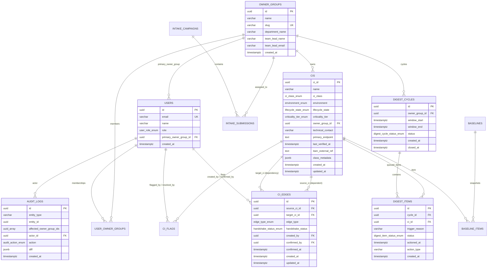

# Database Schema & Migrations Specification

This document details the PostgreSQL 16 schema, DDL migrations, functions, table constraints, triggers, and indexing strategies implemented in `etcms-backend`.

---

## 1. Entity Relationship Diagram (ERD)



---

## 2. Migrations Breakdown

### `00001_init_schema.sql` — Foundation & Core Immutability
- **Extensions:**
  ```sql
  CREATE EXTENSION IF NOT EXISTS "pgcrypto";
  CREATE EXTENSION IF NOT EXISTS "pg_trgm";
  ```
- **Custom Functions:**
  - `fn_jsonb_key_count(j jsonb)`: Returns count of top-level keys in a JSONB object.
    ```sql
    CREATE OR REPLACE FUNCTION fn_jsonb_key_count(j jsonb) RETURNS integer
    LANGUAGE sql IMMUTABLE STRICT AS $$
      SELECT count(*)::integer FROM jsonb_object_keys(j);
    $$;
    ```
  - `trg_audit_logs_prevent_mutation()`: Prohibits `UPDATE`, `DELETE`, or `TRUNCATE` operations on `audit_logs`.
    ```sql
    CREATE OR REPLACE FUNCTION trg_audit_logs_prevent_mutation() RETURNS trigger
    LANGUAGE plpgsql AS $$
    BEGIN
      RAISE EXCEPTION 'audit_logs is append-only: % is strictly prohibited', TG_OP;
    END;
    $$;
    ```
- **Audit Immutability Triggers:**
  ```sql
  CREATE TRIGGER audit_logs_no_update_delete
  BEFORE UPDATE OR DELETE ON audit_logs
  FOR EACH ROW EXECUTE FUNCTION trg_audit_logs_prevent_mutation();

  CREATE TRIGGER audit_logs_no_truncate
  BEFORE TRUNCATE ON audit_logs
  EXECUTE FUNCTION trg_audit_logs_prevent_mutation();
  ```
- **Core Tables:** `owner_groups`, `users`, `user_owner_groups`, `cis`, `ci_edges`, `baselines`, `baseline_items`, `ci_flags`, `audit_logs`.

### `00002_intake_campaigns.sql` — Decentralized Intake Engine
- **Tables:**
  - `intake_campaigns`: Stores campaign metadata and deadlines.
  - `intake_submissions`: Stores tokenized magic link hashes, auto-saved wizard draft payloads (`draft_payload jsonb`), lock versions (`lock_version integer DEFAULT 1`), and submission statuses.
- **Payload Constraint:**
  ```sql
  CHECK (octet_length(draft_payload::text) <= 2097152) -- 2MB max payload size
  ```

### `00003_digests.sql` — Fixed-Window Owner Reviews
- **Enums:**
  - `digest_cycle_status_enum`: `'open'`, `'closed'`
  - `digest_item_status_enum`: `'open'`, `'actioned'`, `'expired'`
- **Tables:**
  - `digest_cycles`: Anchored to 1st and 15th UTC fixed windows with distributed safety:
    ```sql
    CONSTRAINT uq_digest_cycles_group_window UNIQUE (owner_group_id, window_start)
    ```
  - `digest_items`: Queued review items per cycle with deduplication constraint:
    ```sql
    CONSTRAINT uq_digest_items_cycle_ci UNIQUE (cycle_id, ci_id)
    ```

---

## 3. Database Constraints & Invariants

### 1. Class Metadata Limitation
Configuration item metadata is strictly constrained to at most 2 keys:
```sql
CHECK (jsonb_typeof(class_metadata) = 'object' AND fn_jsonb_key_count(class_metadata) <= 2)
```

### 2. Active CI Name Uniqueness
Active CIs must have unique lowercase names per class and environment. Retired CIs are excluded to allow name reuse:
```sql
CREATE UNIQUE INDEX uq_cis_active_name ON cis (lower(name), ci_class, environment)
WHERE lifecycle_state != 'retired';
```

### 3. Canonical Edge Direction & Self-Loop Prevention
- Edge direction is canonical: `source_ci_id` = Consumer / Dependent, `target_ci_id` = Provider / Dependency.
- Self-dependencies are rejected at the database level:
```sql
CHECK (source_ci_id != target_ci_id)
CONSTRAINT uq_ci_edges_source_target_type UNIQUE (source_ci_id, target_ci_id, edge_type)
```

### 4. Append-Only Audit Logs
- The `audit_logs` table has no primary key foreign keys that allow cascading deletes.
- Any attempt by any user or administrator to run `UPDATE`, `DELETE`, or `TRUNCATE` raises an immediate PL/pgSQL exception.

---

## 4. Indexing Strategies & Query Optimization

| Index Name | Table | Columns / Expression | Index Type | Purpose |
| :--- | :--- | :--- | :--- | :--- |
| `idx_cis_name_trgm` | `cis` | `name gin_trgm_ops` | GIN | Hybrid trigram similarity search on CI name. |
| `idx_cis_endpoint_trgm` | `cis` | `primary_endpoint gin_trgm_ops` | GIN | Hybrid trigram similarity search on primary endpoint. |
| `idx_cis_owner_group` | `cis` | `owner_group_id` | B-tree | Group-level catalog filtering and RBAC lookups. |
| `idx_cis_lifecycle_state` | `cis` | `lifecycle_state` | B-tree | In-service vs retired filtering. |
| `idx_ci_edges_source` | `ci_edges` | `source_ci_id` | B-tree | Downward dependency traversal lookups. |
| `idx_ci_edges_target` | `ci_edges` | `target_ci_id` | B-tree | Upward impact traversal and orphan detection. |
| `idx_audit_logs_affected` | `audit_logs` | `affected_owner_group_ids` | GIN | Array membership lookups for group-level audit exports. |
| `idx_audit_logs_created_at` | `audit_logs` | `created_at DESC, id DESC` | B-tree | Keyset cursor pagination for timeline queries. |
