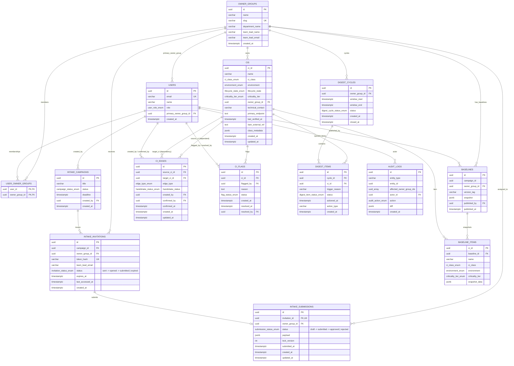

# Database Schema & Migrations Specification

This document details the PostgreSQL 16 schema, DDL migrations, functions, table constraints, triggers, and indexing strategies implemented in `etcms-backend`.

---

## 1. Entity Relationship Diagram (ERD)



> [!NOTE]
> **Discrepancy Flag Reason vs. CI Flag Storage:**
> - When a target team lead flags an edge discrepancy via `POST /api/v1/edges/{id}/flag-mismatch`, the `ci_edges` table updates `handshake_status = 'flagged_mismatch'`. The explanatory `reason` string is **not** stored as a column on `ci_edges`; instead, it is persisted directly in `audit_logs.diff` JSONB (`{"action": "flag_edge_mismatch", "previous_status": "...", "new_status": "flagged_mismatch", "reason": "..."}`).
> - Conversely, configuration item flags reported via `POST /api/v1/cis/{id}/flags` persist `reason` in the dedicated column `ci_flags.reason` (`text NOT NULL`).
> - In the physical relational schema (`00001_init_schema.sql`), baseline items are persisted directly inside `baselines.snapshot` (`jsonb`) as an immutable serialized array of CI records to guarantee atomic, single-row version capture without fragmentation. In the ERD, `BASELINE_ITEMS` represents this logical itemized snapshot relation.

---

## 2. Migrations Breakdown

### `00001_init_schema.sql` — Foundation & Core Immutability
- **Extensions:**
  ```sql
  CREATE EXTENSION IF NOT EXISTS "pgcrypto";
  CREATE EXTENSION IF NOT EXISTS "pg_trgm";
  ```
- **Custom Functions:**
  - `fn_jsonb_key_count(j jsonb)`: Returns count of top-level keys in a JSONB object.
    ```sql
    CREATE OR REPLACE FUNCTION fn_jsonb_key_count(j jsonb) RETURNS integer
    LANGUAGE sql IMMUTABLE STRICT AS $$
      SELECT count(*)::integer FROM jsonb_object_keys(j);
    $$;
    ```
  - `trg_audit_logs_prevent_mutation()`: Prohibits `UPDATE`, `DELETE`, or `TRUNCATE` operations on `audit_logs`.
    ```sql
    CREATE OR REPLACE FUNCTION trg_audit_logs_prevent_mutation() RETURNS trigger
    LANGUAGE plpgsql AS $$
    BEGIN
      RAISE EXCEPTION 'audit_logs is append-only: % is strictly prohibited', TG_OP;
    END;
    $$;
    ```
- **Audit Immutability Triggers:**
  ```sql
  CREATE TRIGGER audit_logs_no_update_delete
  BEFORE UPDATE OR DELETE ON audit_logs
  FOR EACH ROW EXECUTE FUNCTION trg_audit_logs_prevent_mutation();

  CREATE TRIGGER audit_logs_no_truncate
  BEFORE TRUNCATE ON audit_logs
  EXECUTE FUNCTION trg_audit_logs_prevent_mutation();
  ```
- **Core Tables & Entity Definitions:**
  - `owner_groups`: Core organizational ownership entities.
    - Columns: `id UUID PK`, `name VARCHAR(160) NOT NULL`, `slug VARCHAR(80) NOT NULL UNIQUE`, `department_name VARCHAR(160) NOT NULL`, `team_lead_name VARCHAR(160) NOT NULL`, `team_lead_email VARCHAR(255) NOT NULL`, `created_at TIMESTAMPTZ NOT NULL DEFAULT now()`.
  - `users`: Identity and domain roles (`viewer`, `team_lead`, `platform_admin`).
    - Columns: `id UUID PK`, `email VARCHAR(255) NOT NULL UNIQUE`, `name VARCHAR(160) NOT NULL`, `role user_role_enum NOT NULL DEFAULT 'viewer'`, `primary_owner_group_id UUID REFERENCES owner_groups(id) ON DELETE SET NULL`, `created_at TIMESTAMPTZ NOT NULL DEFAULT now()`.
  - `user_owner_groups`: Explicit junction table establishing many-to-many user group memberships.
    - Columns: `user_id UUID NOT NULL REFERENCES users(id) ON DELETE CASCADE`, `owner_group_id UUID NOT NULL REFERENCES owner_groups(id) ON DELETE CASCADE`.
    - Constraints: `PRIMARY KEY (user_id, owner_group_id)`.
  - `cis`: Core Configuration Items catalog.
    - Columns: `ci_id UUID PK`, `name VARCHAR(160) NOT NULL`, `ci_class ci_class_enum NOT NULL`, `environment environment_enum NOT NULL`, `lifecycle_state lifecycle_state_enum NOT NULL DEFAULT 'in_service'`, `criticality_tier criticality_tier_enum NOT NULL`, `owner_group_id UUID NOT NULL REFERENCES owner_groups(id) ON DELETE RESTRICT`, `technical_contact VARCHAR(160) NOT NULL`, `primary_endpoint VARCHAR(255)`, `last_verified_at TIMESTAMPTZ NOT NULL DEFAULT now()`, `itam_external_ref VARCHAR(512)`, `class_metadata JSONB NOT NULL DEFAULT '{}'::jsonb`, `created_at TIMESTAMPTZ NOT NULL DEFAULT now()`, `updated_at TIMESTAMPTZ NOT NULL DEFAULT now()`.
    - Constraints: `chk_cis_class_metadata CHECK (jsonb_typeof(class_metadata) = 'object' AND fn_jsonb_key_count(class_metadata) <= 2)`.
    - Unique Index: `uq_cis_active_name ON cis (lower(name), ci_class, environment) WHERE lifecycle_state != 'retired'`.
  - `ci_edges`: Canonical directed dependency relationships (`source_ci_id = dependent`, `target_ci_id = dependency`).
    - Columns: `id UUID PK`, `source_ci_id UUID NOT NULL REFERENCES cis(ci_id) ON DELETE RESTRICT`, `target_ci_id UUID NOT NULL REFERENCES cis(ci_id) ON DELETE RESTRICT`, `edge_type edge_type_enum NOT NULL`, `handshake_status handshake_status_enum NOT NULL DEFAULT 'pending_confirmation'`, `created_by UUID NOT NULL REFERENCES users(id) ON DELETE RESTRICT`, `confirmed_by UUID REFERENCES users(id) ON DELETE SET NULL`, `confirmed_at TIMESTAMPTZ`, `created_at TIMESTAMPTZ NOT NULL DEFAULT now()`, `updated_at TIMESTAMPTZ NOT NULL DEFAULT now()`.
    - Constraints: `chk_ci_edges_no_self_ref CHECK (source_ci_id != target_ci_id)`, `uq_ci_edges_source_target_type UNIQUE (source_ci_id, target_ci_id, edge_type)`.
  - `baselines`: Published baseline releases per owner group and campaign.
    - Columns: `id UUID PK`, `campaign_id UUID`, `owner_group_id UUID NOT NULL REFERENCES owner_groups(id) ON DELETE RESTRICT`, `version_tag VARCHAR(32) NOT NULL`, `snapshot JSONB NOT NULL`, `published_by UUID NOT NULL REFERENCES users(id) ON DELETE RESTRICT`, `published_at TIMESTAMPTZ NOT NULL DEFAULT now()`.
    - Snapshot Design: The `snapshot` JSONB field stores the complete, immutable serialized array of published CI records and cross-boundary edges captured at baseline publication time.
  - `ci_flags`: Data-quality discrepancy reports reported by users.
    - Columns: `id UUID PK`, `ci_id UUID NOT NULL REFERENCES cis(ci_id) ON DELETE CASCADE`, `flagged_by UUID NOT NULL REFERENCES users(id) ON DELETE RESTRICT`, `reason TEXT NOT NULL`, `status flag_status_enum NOT NULL DEFAULT 'open'`, `created_at TIMESTAMPTZ NOT NULL DEFAULT now()`, `resolved_at TIMESTAMPTZ`, `resolved_by UUID REFERENCES users(id) ON DELETE SET NULL`.
  - `audit_logs`: Append-only, immutable change event log.
    - Columns: `id UUID PK`, `entity_type VARCHAR(64) NOT NULL`, `entity_id UUID NOT NULL`, `affected_owner_group_ids UUID[] NOT NULL DEFAULT '{}'`, `actor_id UUID NOT NULL REFERENCES users(id) ON DELETE RESTRICT`, `action audit_action_enum NOT NULL`, `diff JSONB NOT NULL DEFAULT '{}'::jsonb`, `created_at TIMESTAMPTZ NOT NULL DEFAULT now()`.

### `00002_intake_campaigns.sql` — Decentralized Intake Engine
- **Enums:**
  - `campaign_status_enum`: `'active'`, `'closed'`, `'archived'`
  - `invitation_status_enum`: `'sent'`, `'opened'`, `'submitted'`, `'expired'`
  - `submission_status_enum`: `'draft'`, `'submitted'`, `'approved'`, `'rejected'`
- **Tables:**
  - `intake_campaigns`: Organization-wide baseline collection campaigns created by administrators.
    - Columns: `id UUID PK`, `title VARCHAR(255) NOT NULL`, `status campaign_status_enum NOT NULL DEFAULT 'active'`, `deadline TIMESTAMPTZ NOT NULL`, `created_by UUID NOT NULL REFERENCES users(id) ON DELETE RESTRICT`, `created_at TIMESTAMPTZ NOT NULL DEFAULT now()`.
    - Index: `idx_intake_campaigns_status ON intake_campaigns(status)`.
  - `intake_invitations`: Team lead invitation tokens for guided wizard access.
    - Columns: `id UUID PK`, `campaign_id UUID NOT NULL REFERENCES intake_campaigns(id) ON DELETE CASCADE`, `owner_group_id UUID NOT NULL REFERENCES owner_groups(id) ON DELETE RESTRICT`, `token_hash VARCHAR(64) NOT NULL UNIQUE`, `team_lead_email VARCHAR(255) NOT NULL`, `status invitation_status_enum NOT NULL DEFAULT 'sent'`, `expires_at TIMESTAMPTZ NOT NULL`, `last_accessed_at TIMESTAMPTZ`, `created_at TIMESTAMPTZ NOT NULL DEFAULT now()`.
    - Constraints: `uq_campaign_owner_group UNIQUE (campaign_id, owner_group_id)`.
    - Indexes: `idx_intake_invitations_campaign`, `idx_intake_invitations_token_hash`, `idx_intake_invitations_status`.
  - `intake_submissions`: Auto-saved draft wizard payloads and final submissions.
    - Columns: `id UUID PK`, `invitation_id UUID NOT NULL REFERENCES intake_invitations(id) ON DELETE CASCADE`, `owner_group_id UUID NOT NULL REFERENCES owner_groups(id) ON DELETE RESTRICT`, `status submission_status_enum NOT NULL DEFAULT 'draft'`, `payload JSONB NOT NULL DEFAULT '{}'::jsonb`, `lock_version INT NOT NULL DEFAULT 1`, `submitted_at TIMESTAMPTZ`, `created_at TIMESTAMPTZ NOT NULL DEFAULT now()`, `updated_at TIMESTAMPTZ NOT NULL DEFAULT now()`.
    - Constraints: `uq_invitation_submission UNIQUE (invitation_id)`.
    - Indexes: `idx_intake_submissions_invitation`, `idx_intake_submissions_owner_group`.
    - Concurrency & Size Guards: Optimistic concurrency control via `lock_version` (HTTP `If-Match` header returns `412 Precondition Failed` on mismatch); 2MB payload guard enforced at the HTTP middleware layer.

### `00003_digests.sql` — Fixed-Window Owner Reviews
- **Enums:**
  - `digest_cycle_status_enum`: `'open'`, `'closed'`
  - `digest_item_status_enum`: `'open'`, `'actioned'`, `'expired'`
- **Tables:**
  - `digest_cycles`: Anchored to 1st and 15th UTC fixed windows with distributed safety:
    - Columns: `id UUID PK`, `owner_group_id UUID NOT NULL REFERENCES owner_groups(id) ON DELETE CASCADE`, `window_start TIMESTAMPTZ NOT NULL`, `window_end TIMESTAMPTZ NOT NULL`, `status digest_cycle_status_enum NOT NULL DEFAULT 'open'`, `created_at TIMESTAMPTZ NOT NULL DEFAULT now()`, `closed_at TIMESTAMPTZ`.
    - Constraints: `uq_digest_cycles_group_window UNIQUE (owner_group_id, window_start)`.
  - `digest_items`: Queued review items per cycle with deduplication constraint:
    - Columns: `id UUID PK`, `cycle_id UUID NOT NULL REFERENCES digest_cycles(id) ON DELETE CASCADE`, `ci_id UUID NOT NULL REFERENCES cis(ci_id) ON DELETE CASCADE`, `trigger_reason VARCHAR(64) NOT NULL`, `status digest_item_status_enum NOT NULL DEFAULT 'open'`, `actioned_at TIMESTAMPTZ`, `action_type VARCHAR(32)`, `created_at TIMESTAMPTZ NOT NULL DEFAULT now()`.
    - Constraints: `uq_digest_items_cycle_ci UNIQUE (cycle_id, ci_id)`.

---

## 3. Database Constraints & Invariants

### 1. Class Metadata Limitation
Configuration item metadata is strictly constrained to at most 2 keys:
```sql
CHECK (jsonb_typeof(class_metadata) = 'object' AND fn_jsonb_key_count(class_metadata) <= 2)
```

### 2. Active CI Name Uniqueness
Active CIs must have unique lowercase names per class and environment. Retired CIs are excluded to allow name reuse:
```sql
CREATE UNIQUE INDEX uq_cis_active_name ON cis (lower(name), ci_class, environment)
WHERE lifecycle_state != 'retired';
```

### 3. Canonical Edge Direction & Self-Loop Prevention
- Edge direction is canonical: `source_ci_id` = Consumer / Dependent, `target_ci_id` = Provider / Dependency.
- Self-dependencies are rejected at the database level:
```sql
CHECK (source_ci_id != target_ci_id)
CONSTRAINT uq_ci_edges_source_target_type UNIQUE (source_ci_id, target_ci_id, edge_type)
```

### 4. Append-Only Audit Logs
- The `audit_logs` table defines no `ON DELETE CASCADE` foreign key constraints.
- Any attempt by any user or administrator to run `UPDATE`, `DELETE`, or `TRUNCATE` raises an immediate PL/pgSQL exception.

---

## 4. Indexing Strategies & Query Optimization

| Index Name | Table | Columns / Expression | Index Type | Purpose |
| :--- | :--- | :--- | :--- | :--- |
| `idx_cis_name_trgm` | `cis` | `name gin_trgm_ops` | GIN | Hybrid trigram similarity search on CI name. |
| `idx_cis_endpoint_trgm` | `cis` | `primary_endpoint gin_trgm_ops` | GIN | Hybrid trigram similarity search on primary endpoint. |
| `idx_cis_owner_group` | `cis` | `owner_group_id` | B-tree | Group-level catalog filtering and RBAC lookups. |
| `idx_cis_lifecycle_state` | `cis` | `lifecycle_state` | B-tree | In-service vs retired filtering. |
| `idx_ci_edges_source` | `ci_edges` | `source_ci_id` | B-tree | Downward dependency traversal lookups *(redundant with unique constraint leading column)*. |
| `idx_ci_edges_target` | `ci_edges` | `target_ci_id` | B-tree | Upward impact traversal and orphan detection. |
| `idx_ci_edges_handshake` | `ci_edges` | `handshake_status` | B-tree | Pending cross-boundary edge filtering and confirmation queues. |
| `idx_audit_logs_affected` | `audit_logs` | `affected_owner_group_ids` | GIN | Array membership lookups for group-level audit exports. |
| `idx_audit_logs_created_at` | `audit_logs` | `created_at DESC, id DESC` | B-tree | Keyset cursor pagination for timeline queries. |

> [!NOTE]
> **Index Redundancy Note on `idx_ci_edges_source`:**
> The unique constraint `uq_ci_edges_source_target_type UNIQUE (source_ci_id, target_ci_id, edge_type)` creates a composite unique B-tree index in PostgreSQL. Because `source_ci_id` is the leftmost (leading) column, queries filtering solely on `WHERE source_ci_id = ...` can utilize this unique index directly. Consequently, `idx_ci_edges_source ON ci_edges (source_ci_id)` is technically redundant for leading-column lookups. Conversely, `idx_ci_edges_target ON ci_edges (target_ci_id)` is **non-redundant and essential** because `target_ci_id` sits in the secondary position of the composite unique index and cannot be evaluated independently as an index leading prefix.
