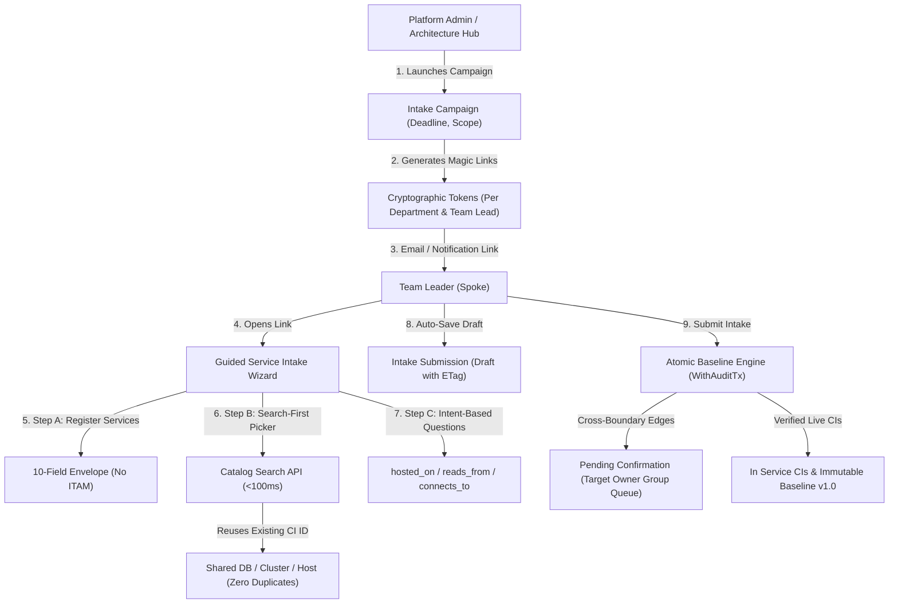

# `etcms` — Go & OpenAPI Backend Implementation Sprint Plan (v3.0 Decentralized Intake Edition)

**Document Version:** 3.0 (Decentralized Service Intake & Production-Hardened Edition)  
**Scope:** Backend API & Worker Services Only (4 Epics, 13 User Stories — Enterprise Infrastructure & Systems CMDB MVP)  
**Architecture:** OpenAPI 3.0.3 Contract-First, Go 1.27 (`chi` + `oapi-codegen`), PostgreSQL 16 (`pgx/v5` + `sqlc` + `goose`)  
**Companion Execution Prompts:** [etcms_execution_prompts.md](file:///home/nahom/Work/ET/etcms/etcms-backend/etcms_execution_prompts.md)  

---

## 1. Backend Scope & OpenAPI-First Principles

`etcms` is an enterprise-grade, manual-first **Configuration Management System (CMS)** backend aligned with ITIL v4 Service Configuration Management and modern Service Catalog architectures (e.g. CSDM, Backstage). It replaces bureaucratic workshops with **Decentralized Service Intake Campaigns**—distributing secure, tokenized intake links to Department Team Leaders to register services, applications, and dependencies without redundant data entry or unverified ghost CIs.

It exposes a strictly typed REST API powering tokenized intake campaigns, sub-500ms upward/downward graph traversal, cross-boundary owner handshakes, immutable audit logging, and bi-weekly owner verification digests—with **zero bulk import endpoints** and **zero external ticketing/ITAM integrations**.

### 1.1 Contract-First OpenAPI 3.0.3 Engineering Principles

To prevent AI agent drift between API documentation, request validation, and Go handler code, every feature follows a strict **Spec $\rightarrow$ Codegen $\rightarrow$ SQL $\rightarrow$ Handler** pipeline:

1. **OpenAPI 3.0.3 as the Tooling Standard:** To guarantee 100% code-generation and validation stability across `oapi-codegen/v2` and `kin-openapi`, the API contract is authored in OpenAPI 3.0.3 using native `nullable: true` syntax (avoiding partial 3.1 tooling support for type arrays and `$schema`).
2. **Flattened Schemas (No `allOf` + `additionalProperties: false` Collisions):** All composite request and response DTOs (such as `CIEnvelope` containing `OwnershipHeader`) are defined as **flattened schemas** with top-level `additionalProperties: false`.
3. **Strict Anti-ITAM Schema Enforcement:** Any payload containing unapproved ITAM fields (such as `cost`, `purchase_cost`, `license_count`, `warranty_end`, or `vendor`) is rejected at the OpenAPI validation middleware layer with HTTP `422 Unprocessable Entity`.
4. **Generated Server Interfaces (`oapi-codegen`):** Handlers implement the generated `StrictServerInterface` in `internal/adapters/http/gen/openapi.gen.go` rather than hand-writing router bindings or raw JSON unmarshaling.
5. **Clear HTTP Error Semantics (RFC 9457):**
   * **`HTTP 400 Bad Request`:** Reserved strictly for unparseable syntax (malformed JSON, invalid UUID format, illegal query parameter types).
   * **`HTTP 401 Unauthorized`:** Missing or expired bearer tokens / intake campaign invitation tokens.
   * **`HTTP 403 Forbidden`:** Domain write RBAC violations (e.g., non-owner modifying a CI).
   * **`HTTP 404 Not Found`:** Resource does not exist or intake token not found.
   * **`HTTP 409 Conflict`:** State-machine or dependency conflicts (e.g., retiring a CI with active upstream dependents).
   * **`HTTP 412 Precondition Failed`:** Optimistic concurrency conflict on draft auto-saves (`If-Match` version mismatch).
   * **`HTTP 422 Unprocessable Entity`:** Syntactically valid JSON that violates schema constraints or business rules (extra ITAM properties, missing mandatory envelope fields, intake node errors).
6. **Breaking-Change CI Gate (`oasdiff`):** The build pipeline runs `oasdiff` against the previous baseline specification in CI to ensure no breaking changes are introduced for future consumers.

---

### 1.2 Real-World Naming Conventions & Domain Constraints

To eliminate archaic terminology, bureaucratic friction, and URL-encoding bugs across HTTP reverse proxies (such as AWS ALB or Nginx), **all custodian references are replaced with modern ownership terminology (`owner_group`, `team_lead`)**, and all enums use canonical `snake_case` values.

#### Canonical Enum Taxonomy

* **`ci_class_enum`:** `business_service`, `application`, `database`, `vm_cluster`, `physical_host`, `network_firewall`
* **`lifecycle_state_enum`:** `planned`, `in_service`, `deprecated`, `retired`
* **`criticality_tier_enum`:** `tier_0`, `tier_1`, `tier_2`, `tier_3`
* **`edge_type_enum`:** `depends_on`, `hosted_on`, `connects_to`, `reads_from`
* **`handshake_status_enum`:** `pending_confirmation`, `confirmed`, `flagged_mismatch`, `rejected`
* **`campaign_status_enum`:** `active`, `closed`, `archived`
* **`invitation_status_enum`:** `sent`, `opened`, `submitted`, `expired`
* **`submission_status_enum`:** `draft`, `submitted`, `approved`, `rejected`
* **`flag_status_enum`:** `open`, `resolved`, `dismissed`
* **`digest_cycle_status_enum`:** `open`, `closed`
* **`digest_item_status_enum`:** `open`, `actioned`, `expired`
* **`user_role_enum`:** `viewer`, `team_lead`, `platform_admin`
* **`audit_action_enum`:** `create`, `update`, `retire`, `verify`, `confirm`, `flag`, `disconnect`

#### Canonical Edge Direction Standard

In graph systems, directional ambiguity causes significant data corruption. `etcms` strictly enforces:
* **`source_ci_id` = Dependent / Consumer** (e.g., `Application` that requires a database, or `VM` hosted on a server).
* **`target_ci_id` = Dependency / Provider** (e.g., `Database` providing data, or `Physical Host` providing compute).
* **Upward Impact Traversal:** Following incoming edges from provider to consumers (`target_ci_id = :start_id -> source_ci_id`). Answers: *"If this database fails, what services/applications break?"*
* **Downward Dependency Traversal:** Following outgoing edges from consumer to providers (`source_ci_id = :start_id -> target_ci_id`). Answers: *"What infrastructure components does this application depend on?"*
* **Self-Dependency Constraint:** `CHECK (source_ci_id != target_ci_id)` is enforced at the database level.

#### CI 10-Field Governance Envelope

| # | Field Name | OpenAPI 3.0.3 Schema Type | PostgreSQL 16 Type | Governance Constraint |
| :--- | :--- | :--- | :--- | :--- |
| 1 | `ci_id` | `string` (`format: uuid`, `readOnly: true`) | `UUID PRIMARY KEY DEFAULT gen_random_uuid()` | Immutable v4 UUID |
| 2 | `name` | `string` (`minLength: 1`, `maxLength: 160`) | `VARCHAR(160) NOT NULL` | Indexed for trigram & prefix search |
| 3 | `ci_class` | `string` (`enum: [business_service, application, database, vm_cluster, physical_host, network_firewall]`) | `ci_class_enum NOT NULL` | Locked Phase 1 taxonomy |
| 4 | `environment` | `string` (`enum: [prod, dr, staging]`) | `environment_enum NOT NULL` | Required environment tier |
| 5 | `lifecycle_state` | `string` (`enum: [planned, in_service, deprecated, retired]`) | `lifecycle_state_enum NOT NULL DEFAULT 'in_service'` | No hard deletes; retire via state |
| 6 | `criticality_tier` | `string` (`enum: [tier_0, tier_1, tier_2, tier_3]`) | `criticality_tier_enum NOT NULL` | Drives blast-radius calculations |
| 7 | `owner_group_id` | `string` (`format: uuid`) | `UUID NOT NULL REFERENCES owner_groups(id)` | **Required**; governs write RBAC |
| 8 | `technical_contact` | `string` (`minLength: 1`, `maxLength: 160`) | `VARCHAR(160) NOT NULL` | **Required**; named engineer/handle |
| 9 | `primary_endpoint` | `string` (`nullable: true`, `maxLength: 255`) | `VARCHAR(255)` | Indexed IP, VIP, FQDN, or URI |
| 10 | `last_verified_at` | `string` (`format: date-time`, `readOnly: true`) | `TIMESTAMPTZ NOT NULL DEFAULT now()` | Stamped on publish, verify, or volatile edit |
| *Opt* | `itam_external_ref` | `string` (`nullable: true`, `maxLength: 512`) | `VARCHAR(512)` | Read-only pointer to external ITAM |
| *Ext* | `class_metadata` | `object` (`maxProperties: 2`, `additionalProperties: {type: string}`) | `JSONB NOT NULL DEFAULT '{}'::jsonb` | DB `CHECK` via `fn_jsonb_key_count()` $\le 2$ |

* **Active CI Uniqueness:** Prohibits duplicate active CIs across the enterprise:
  `CREATE UNIQUE INDEX uq_cis_active_name ON cis (lower(name), ci_class, environment) WHERE lifecycle_state != 'retired';`
* **Refined Verification Stamping:** `last_verified_at = now()` is stamped **only** upon:
  1. Initial publication into `in_service`.
  2. Explicit verification via `POST /api/v1/cis/{id}/verify`.
  3. Mutation of volatile operational fields (`primary_endpoint`, `technical_contact`, `owner_group_id`, `criticality_tier`).  
  *Cosmetic edits (e.g. `class_metadata` or typo corrections) update `updated_at` only, preserving metric integrity.*

---

## 2. Decentralized Service Intake Architecture & Best Design Principles

Rather than forcing hundreds of engineers into synchronous workshops or asking them to draft complex graph canvases from scratch, `etcms` implements a **Governed Central-Hub / Distributed-Spoke Intake Campaign**:



### 2.1 Core Intake Design Principles

1. **Secure Tokenized Magic Links (Zero Account Provisioning Hurdle):**
   * Platform Admins generate an `intake_campaign` with a deadline.
   * The backend generates cryptographically secure, single-use, expiring bearer tokens (`intake_invitations`) mapped to `(owner_group_id, department_name, team_lead_email)`.
   * Team leaders click their link and land directly in their team-scoped intake wizard without needing prior manual account provisioning.
2. **Search-First Dependency Selection (Zero Duplicate Infrastructure CIs):**
   * When a team leader indicates their application uses a database, runs on a cluster, or calls another service, they **must search the catalog first** using the high-speed trigram/prefix search API (`GET /api/v1/cis/search`).
   * Selecting an existing infrastructure CI references its existing `ci_id`. This **strictly eliminates duplicate orphan databases, hosts, and clusters**.
   * If a dependent service does not yet exist in the catalog, the wizard creates a **Controlled Dependency Stub** with a designated target department/team, queuing it for cross-team reconciliation.
3. **Intent-Based Guided Questions (No Raw Graph Modeling):**
   * Team leaders answer intuitive, domain-level questions:
     * *"Where does this application run?"* $\rightarrow$ Generates `hosted_on` edge pointing to a `vm_cluster` or `physical_host`.
     * *"Which databases or storage engines does this application store data in?"* $\rightarrow$ Generates `reads_from` edge pointing to a `database`.
     * *"Which other internal services does this application invoke via API or message bus?"* $\rightarrow$ Generates `connects_to` edge pointing to an `application` or `business_service`.
     * *"Which business service does this application support?"* $\rightarrow$ Generates `depends_on` edge pointing to a `business_service`.
   * The backend automatically maps these answers to the strict edge direction convention: `source_ci_id` = Application (Consumer) and `target_ci_id` = Dependency (Provider).
4. **Automated Cross-Team Handshake Workflows:**
   * Whenever an intake links an application to an infrastructure CI owned by another team (e.g. Infrastructure or Database SRE), the edge is created with `handshake_status = 'pending_confirmation'`.
   * The provider team lead sees this in their pending edge queue (`GET /api/v1/owner-groups/pending-edges`) and can confirm or flag mismatches with one click.
5. **Optimistic Draft Concurrency & Size Limits:**
   * Intake drafts auto-save to `intake_submissions` with a strict **2MB body size limit**.
   * Concurrent edits use `If-Match: "<lock_version>"` to return `412 Precondition Failed` on version conflicts.

---

## 3. Go 1.27 + OpenAPI Tech Stack & Repository Layout

### 3.1 Core Toolchain

* **Language & Runtime:** Go `1.27+`
* **OpenAPI Tooling:**
  * `oapi-codegen/v2` (generates `chi` strict server interfaces and models from `api/openapi.yaml`)
  * `getkin/kin-openapi` (runtime request/response validation middleware against `openapi.yaml`)
  * `oasdiff` (detects breaking schema changes against previous git revisions)
* **HTTP & Middleware:** `go-chi/chi/v5`, `chi/httprate` (rate limiting), `log/slog` (structured JSON logging with trace context)
* **Database & Type-Safe SQL:**
  * `PostgreSQL 16` (with `pg_trgm` and `pgcrypto` extensions)
  * `jackc/pgx/v5` (`pgxpool` connection pooling & transactional contexts)
  * `sqlc` (compiles `.sql` queries into type-safe Go structs and methods)
  * `pressly/goose/v3` (embedded SQL schema migrations with `-- +goose Up` and `-- +goose Down`)
* **Testing & Quality:**
  * `stretchr/testify` + `testcontainers/testcontainers-go` (real PostgreSQL 16 containers for integration & benchmark tests)
  * `golangci-lint` (enforces `errcheck`, `govet`, `revive`, `staticcheck`, `exhaustive`)

### 3.2 Clean Hexagonal Directory Structure

```text
etcms-backend/
├── AGENTS.md                         # AI agent guardrails & non-negotiable rules
├── .agents/skills/                   # Modular agent skill playbooks
│   ├── openapi-contract-first.md     # OpenAPI spec editing, linting & codegen
│   ├── sqlc-postgres-audit.md        # Goose DDL, immutable triggers & WithAuditTx
│   ├── go-recursive-graph.md         # Cycle-safe graph traversal & shared-dep math
│   └── backend-tdd-testcontainers.md # Table-driven testcontainers integration tests
├── api/
│   └── openapi.yaml                  # Single source of truth (OpenAPI 3.0.3 spec)
├── oapi-codegen.yaml                 # Code generation configuration
├── sqlc.yaml                         # SQL-to-Go compiler configuration
├── Makefile                          # generate, migrate, lint, test, bench, diff-spec
├── docker-compose.yml                # Local PostgreSQL 16 instance
├── cmd/
│   ├── etcms-api/
│   │   └── main.go                   # Server wiring, graceful shutdown, health/ready probes
│   └── etcms-migrate/
│       └── main.go                   # Standalone CLI migration runner
├── migrations/
│   ├── 00001_init_schema.sql         # Base DDL, functions, triggers, constraints
│   ├── 00002_intake_campaigns.sql    # Intake campaigns, tokens, and submissions
│   └── 00003_digests.sql             # Fixed-window owner digest tables and indexes
├── sql/
│   └── queries/
│       ├── users.sql                 # User & owner group queries
│       ├── intake.sql                # Campaign management, token validation, submissions
│       ├── cis.sql                   # CI CRUD, hybrid trigram/prefix search
│       ├── graph_traversal.sql       # Cycle-safe upward & downward queries
│       ├── edges.sql                 # Cross-boundary edge handshakes & lifecycle
│       ├── digests.sql               # Fixed-window owner queue generation
│       ├── audit_logs.sql            # Append-only audit queries & export
│       └── health_metrics.sql        # Governance KPI aggregations
└── internal/
    ├── domain/                       # Pure Go domain models, errors, RBAC policies
    ├── service/                      # Business logic, audit orchestrator, notifier
    │   ├── intake.go                 # Campaign & magic-link submission engine
    │   └── notifier.go               # Outbound webhook & notification dispatcher
    ├── worker/                       # Fixed-window digest scheduler & runner
    └── adapters/
        ├── http/
        │   ├── gen/                  # GENERATED by oapi-codegen (DO NOT EDIT)
        │   ├── handler/              # StrictServerInterface implementations
        │   ├── middleware/           # OpenAPI validator, Auth/RBAC, rate-limit, trace
        │   └── docs.go               # Embedded OpenAPI spec & Swagger UI
        └── postgres/
            ├── gen/                  # GENERATED by sqlc (DO NOT EDIT)
            └── tx.go                 # Transactional audit wrapper (WithAuditTx)
```

---

## 4. Sprint Plan (Sprint 0 – Sprint 3, 13 User Stories)

### Sprint Overview

| Sprint | Duration | Epics & Stories Covered | Primary Backend Deliverable |
| :--- | :--- | :--- | :--- |
| **Sprint 0** | Week 1 | Foundation, OpenAPI Pipeline, DB & RBAC | Go 1.27 module, OpenAPI 3.0.3 base, PostgreSQL 16 DDL with immutable triggers, `WithAuditTx`, RBAC middleware, liveness/readiness probes |
| **Sprint 1** | Weeks 2–3 | **Epic 1 & Epic 2** (`US-1.1`, `US-1.2`, `US-2.1`, `US-2.2`, `US-2.3`, `US-2.4`, `US-2.5`) | Decentralized Intake Campaigns, Tokenized Magic Links, Search-First Intake Wizard API, Atomic Baseline Publisher, Edge Handshakes, and Post-Baseline Lifecycle |
| **Sprint 2** | Weeks 4–5 | **Epic 3** (`US-3.1`, `US-3.2`, `US-3.3`) + Cross-Team Flagging | Sub-500ms Upward Impact & Downward Shared-Dependency Traversal, Trigram/Prefix Search, CI Detail API, Domain `PATCH` & Flagging |
| **Sprint 3** | Weeks 6–7 | **Epic 4** (`US-4.1`, `US-4.2`, `US-4.3`) + Hardening | Fixed-window 14-Day Owner Digest Worker & Action APIs, Streaming CSV/NDJSON Audit Export with formula sanitization, CMDB Health Metrics API |

---

## Sprint 0: Foundation, OpenAPI Pipeline & Transactional Audit Core (Week 1)

**Sprint Goal:** Bootstrap the Go 1.27 service, establish OpenAPI 3.0.3 code generation with flattened schemas, create PostgreSQL 16 migrations with trigger-enforced immutability and valid `CHECK` constraints, wire `WithAuditTx`, and implement multi-group RBAC middleware with strict environment guards.

### Tasks

* **S0-1: Repository, Toolchain & Guardrails Setup**
  * Initialize `go.mod` (Go `1.27`, `github.com/org/etcms-backend`), `docker-compose.yml` (`postgres:16-alpine`), `.golangci.yml`, and `Makefile` targets (`generate`, `migrate-up`, `migrate-down`, `lint`, `test`, `bench`, `diff-spec`).
  * Install `oasdiff` in Makefile for breaking-change detection.
  * Create `AGENTS.md` and the 4 `.agents/skills/*.md` playbooks.
* **S0-2: Base OpenAPI 3.0.3 Specification & Codegen (`api/openapi.yaml`)**
  * Define base components with flattened schemas (avoiding `allOf` + `additionalProperties: false` issues):
    * `OwnershipHeader` (`owner_group_id`, `owner_group_name`, `department_name`, `technical_contact`).
    * `CIEnvelope` (10-field core + `class_metadata` + `ownership` object, `additionalProperties: false`).
    * `ProblemDetails` (RFC 9457 with `type`, `title`, `status`, `detail`, `instance`, and optional `errors`).
    * `GET /api/v1/healthz` (liveness probe), `GET /api/v1/readyz` (readiness probe with PostgreSQL ping), `GET /api/v1/users/me`, and `GET /api/v1/owner-groups`.
  * Configure `oapi-codegen.yaml` for `chi` strict server interfaces and `kin-openapi` request/response validation middleware.
  * Expose embedded docs at `GET /docs` and `GET /openapi.yaml`.
* **S0-3: PostgreSQL 16 Schema (`migrations/00001_init_schema.sql`) & `sqlc`**
  * Enable `pg_trgm` and `pgcrypto` extensions.
  * **Function for `class_metadata` constraint:**
    ```sql
    CREATE OR REPLACE FUNCTION fn_jsonb_key_count(j jsonb) RETURNS integer
    LANGUAGE sql IMMUTABLE STRICT AS $$
      SELECT count(*)::integer FROM jsonb_object_keys(j);
    $$;
    ```
    Table constraint on `cis`: `CHECK (jsonb_typeof(class_metadata) = 'object' AND fn_jsonb_key_count(class_metadata) <= 2)`.
  * **Trigger functions for audit immutability:**
    ```sql
    CREATE OR REPLACE FUNCTION trg_audit_logs_prevent_mutation() RETURNS trigger
    LANGUAGE plpgsql AS $$
    BEGIN
      RAISE EXCEPTION 'audit_logs is append-only: % is strictly prohibited', TG_OP;
    END;
    $$;

    CREATE TRIGGER audit_logs_no_update_delete
    BEFORE UPDATE OR DELETE ON audit_logs
    FOR EACH ROW EXECUTE FUNCTION trg_audit_logs_prevent_mutation();

    CREATE TRIGGER audit_logs_no_truncate
    BEFORE TRUNCATE ON audit_logs
    EXECUTE FUNCTION trg_audit_logs_prevent_mutation();
    ```
  * Create tables with foreign keys and cascading rules:
    * `owner_groups` (`id UUID PRIMARY KEY DEFAULT gen_random_uuid()`, `name VARCHAR(160) NOT NULL`, `slug VARCHAR(80) NOT NULL UNIQUE`, `department_name VARCHAR(160) NOT NULL`, `team_lead_name VARCHAR(160) NOT NULL`, `team_lead_email VARCHAR(255) NOT NULL`, `created_at TIMESTAMPTZ NOT NULL DEFAULT now()`).
    * `users` (`id UUID PRIMARY KEY DEFAULT gen_random_uuid()`, `email VARCHAR(255) NOT NULL UNIQUE`, `name VARCHAR(160) NOT NULL`, `role user_role_enum NOT NULL DEFAULT 'viewer'`, `primary_owner_group_id UUID REFERENCES owner_groups(id)`, `created_at TIMESTAMPTZ NOT NULL DEFAULT now()`).
    * `user_owner_groups` (`user_id UUID REFERENCES users(id) ON DELETE CASCADE`, `owner_group_id UUID REFERENCES owner_groups(id) ON DELETE CASCADE`, `PRIMARY KEY (user_id, owner_group_id)`).
    * `cis` (10 core fields + `itam_external_ref` + `class_metadata` + unique index `uq_cis_active_name ON cis (lower(name), ci_class, environment) WHERE lifecycle_state != 'retired'`).
    * `ci_edges` (`id UUID PRIMARY KEY DEFAULT gen_random_uuid()`, `source_ci_id UUID NOT NULL REFERENCES cis(ci_id) ON DELETE RESTRICT`, `target_ci_id UUID NOT NULL REFERENCES cis(ci_id) ON DELETE RESTRICT`, `edge_type edge_type_enum NOT NULL`, `handshake_status handshake_status_enum NOT NULL DEFAULT 'pending_confirmation'`, `created_by UUID NOT NULL REFERENCES users(id)`, `confirmed_by UUID REFERENCES users(id)`, `confirmed_at TIMESTAMPTZ`, `created_at TIMESTAMPTZ NOT NULL DEFAULT now()`, `updated_at TIMESTAMPTZ NOT NULL DEFAULT now()`, `CHECK (source_ci_id != target_ci_id)`, `CONSTRAINT uq_ci_edges_source_target_type UNIQUE (source_ci_id, target_ci_id, edge_type)`).
    * `baselines` (`id UUID PRIMARY KEY DEFAULT gen_random_uuid()`, `campaign_id UUID`, `owner_group_id UUID NOT NULL REFERENCES owner_groups(id)`, `version_tag VARCHAR(32) NOT NULL`, `snapshot JSONB NOT NULL`, `published_by UUID NOT NULL REFERENCES users(id)`, `published_at TIMESTAMPTZ NOT NULL DEFAULT now()`).
    * `ci_flags` (`id UUID PRIMARY KEY DEFAULT gen_random_uuid()`, `ci_id UUID NOT NULL REFERENCES cis(ci_id) ON DELETE CASCADE`, `flagged_by UUID NOT NULL REFERENCES users(id)`, `reason TEXT NOT NULL`, `status flag_status_enum NOT NULL DEFAULT 'open'`, `created_at TIMESTAMPTZ NOT NULL DEFAULT now()`, `resolved_at TIMESTAMPTZ`, `resolved_by UUID REFERENCES users(id)`).
    * `audit_logs` (`id UUID PRIMARY KEY DEFAULT gen_random_uuid()`, `entity_type VARCHAR(64) NOT NULL`, `entity_id UUID NOT NULL`, `affected_owner_group_ids UUID[] NOT NULL DEFAULT '{}'`, `actor_id UUID NOT NULL REFERENCES users(id)`, `action audit_action_enum NOT NULL`, `diff JSONB NOT NULL DEFAULT '{}'::jsonb`, `created_at TIMESTAMPTZ NOT NULL DEFAULT now()`).
* **S0-4: Transactional Audit Wrapper (`WithAuditTx`) & Auth Middleware**
  * Implement `postgres.Store.WithAuditTx(ctx, actor, fn)`:
    * Sets PostgreSQL transaction session config: `set_config('etcms.actor_id', actor.ID.String(), true)`.
    * Inserts append-only audit records containing structured JSONB diffs and `affected_owner_group_ids`.
  * Implement Auth & Multi-Group RBAC middleware:
    * Extracts authenticated user, role (`viewer`, `team_lead`, `platform_admin`), and all group memberships from `user_owner_groups`.
    * In non-development/non-test environments (`APP_ENV != "development"` and `APP_ENV != "test"`), server startup fails if `ALLOW_DEV_AUTH_HEADER=true`, and incoming `X-Dev-User-ID` headers are ignored.

### Sprint 0 Verification Gate
* `make generate && make lint` exits `0`.
* `testcontainers-go` test proves:
  1. An `UPDATE`, `DELETE`, or `TRUNCATE` query on `audit_logs` raises a PostgreSQL exception.
  2. Inserting a CI with $>2$ keys in `class_metadata` or a non-object payload fails the `CHECK` constraint.
  3. Setting `APP_ENV=production` and attempting to use `X-Dev-User-ID` is rejected.
  4. Liveness (`/healthz`) and readiness (`/readyz`) return HTTP 200 with database status.

---

## Sprint 1: Decentralized Intake Campaigns, Baseline Engine & Post-Baseline Lifecycle (Weeks 2–3)

**Sprint Goal:** Implement **Epic 1 & Epic 2** (`US-1.1`, `US-1.2`, `US-2.1`, `US-2.2`, `US-2.3`, `US-2.4`, `US-2.5`) in OpenAPI 3.0.3 and Go—supporting campaign generation, secure tokenized magic links for Department Team Leaders, search-first dependency mapping (zero duplicate CIs), atomic baseline validation and publishing with row locks, cross-boundary edge handshakes, and post-baseline single-CI/edge lifecycle management.

### Tasks & Story Mapping

* **S1-1: OpenAPI Spec Expansion for Campaigns, Intake & Baselines**
  * Update `api/openapi.yaml` and run `make generate`:
    * `POST /api/v1/admin/intake/campaigns` (`title`, `deadline`, `owner_group_ids[]`)
    * `GET /api/v1/admin/intake/campaigns/{id}/progress` (tracking sent, opened, submitted per department)
    * `GET /api/v1/intake/{token}` (retrieves team context, existing CIs, active draft)
    * `PATCH /api/v1/intake/{token}` (draft auto-save with `If-Match` ETag header)
    * `POST /api/v1/intake/{token}/submit` (atomic baseline validation & publishing)
    * `GET /api/v1/owner-groups/pending-edges`
    * `POST /api/v1/edges/{id}/confirm`, `POST /api/v1/edges/{id}/flag-mismatch`, `POST /api/v1/edges/{id}/reject`
    * `POST /api/v1/cis` (single CI create post-baseline), `POST /api/v1/edges`, `DELETE /api/v1/edges/{id}`
  * Run `make diff-spec` to verify backward compatibility.
* **S1-2: Intake Campaigns & Tokenized Magic Link Infrastructure (`US-2.1`)**
  * Add `migrations/00002_intake_campaigns.sql`:
    * `intake_campaigns` (`id`, `title`, `status`, `deadline`, `created_by`, `created_at`).
    * `intake_invitations` (`id`, `campaign_id`, `owner_group_id`, `token_hash VARCHAR(64) UNIQUE`, `team_lead_email`, `status`, `expires_at`, `last_accessed_at`).
    * `intake_submissions` (`id`, `invitation_id`, `owner_group_id`, `status`, `payload JSONB`, `lock_version INT DEFAULT 1`, `submitted_at`, `created_at`, `updated_at`).
  * Implement `CreateCampaign` handler: generates cryptographically secure 32-byte URL tokens, stores SHA-256 hashes in `intake_invitations`, and returns invitation URLs (`/intake/{token}`) ready for email/messaging dispatch.
  * Implement `GetCampaignProgress`: aggregates submission progress by department.
* **S1-3: Controlled Guided Intake Wizard & Search-First Dependency Auto-Save (`US-2.2`)**
  * Implement `GetInvitationByToken`:
    * Validates token hash, checks expiration (`expires_at > now()`), updates `last_accessed_at` and `status = 'opened'`.
    * Returns pre-populated team context (`owner_group_name`, `department_name`, `team_lead_name`), any existing registered CIs owned by this group, and current draft payload.
  * Implement `SaveIntakeDraft` (`PATCH /api/v1/intake/{token}`):
    * Enforces a strict **2MB** payload size limit.
    * Requires `If-Match: "<lock_version>"` header; increments `lock_version` or returns `HTTP 412 Precondition Failed` on version conflict.
    * Stores services, applications, and selected dependencies in `intake_submissions.payload`.
* **S1-4: Atomic Baseline Publisher & Cross-Team Handshakes (`US-1.1`, `US-1.2`, `US-2.3`, `US-2.4`)**
  * Implement `SubmitIntake` (`POST /api/v1/intake/{token}/submit`) with `Idempotency-Key` header support:
    1. Acquire row lock on `intake_submissions` (`FOR UPDATE`). If already `'submitted'` or `'approved'`, return existing baseline or `409 Conflict`.
    2. **Pre-flight Envelope Validation:**
       * Validate every declared service/application against the strict 10-field envelope (`name`, `ci_class`, `environment`, `criticality_tier`, `owner_group_id`, `technical_contact`).
       * Verify `class_metadata` $\le 2$ keys and no unapproved ITAM fields exist.
       * If validation fails on any item, abort and return `422 Unprocessable Entity` with `node_errors: map[string][]string`. No changes are written to `cis`.
    3. **Search-First Dependency Linking & Deduplication:**
       * For every relationship (`hosted_on`, `reads_from`, `connects_to`, `depends_on`), link to the selected existing `target_ci_id`.
       * Enforce edge direction: `source_ci_id` = Team's application, `target_ci_id` = Selected database/host/service.
    4. **Atomic Database Publication inside `WithAuditTx`:**
       * Upsert CIs into `cis` (`lifecycle_state = 'in_service'`, `last_verified_at = now()`).
       * Insert edges into `ci_edges`: set `handshake_status = 'confirmed'` if source and target have the same `owner_group_id`; set `'pending_confirmation'` if cross-boundary.
       * Transition invitation status to `'submitted'` and submission status to `'approved'`.
       * Persist immutable snapshot in `baselines` (`version_tag = 'v1.0'`).
       * Write audit records for all entities.
* **S1-5: Cross-Boundary Edge Handshake Service (`US-2.4`)**
  * Implement `ListPendingEdges` filtered to edges where `target_ci.owner_group_id` matches the authenticated user's groups.
  * Implement `ConfirmEdge`, `FlagEdgeMismatch`, and `RejectEdge`:
    * RBAC: Only a member of `target_ci.owner_group_id` or `platform_admin` may confirm or reject.
    * Record mutation in `audit_logs` with both source and target owner group IDs in `affected_owner_group_ids`.
* **S1-6: Post-Baseline Single-CI & Edge Lifecycle Management (`US-2.5`)**
  * Implement `POST /api/v1/cis` (single CI create post-baseline; owner RBAC, 10-field envelope, active name uniqueness).
  * Implement `POST /api/v1/edges` (single edge create; initiates handshake if cross-boundary).
  * Implement `DELETE /api/v1/edges/{id}` (soft-disconnects edge with audit log).

### Sprint 1 Verification Gate
* `testcontainers-go` integration suite verifies:
  1. Payload containing `purchase_cost` returns `422 Unprocessable Entity` (`US-1.1`).
  2. Submitting an intake missing `technical_contact` returns `422` with exact `node_errors` and creates 0 rows in `cis` (`US-1.2`, `US-2.3`).
  3. Generating a campaign generates secure token links, tracks department progress, and rejects expired tokens with `401` (`US-2.1`).
  4. Search-first dependency mapping reuses existing database `ci_id` without creating duplicate CIs (`US-2.2`).
  5. Cross-boundary edges are created with `pending_confirmation` and can be confirmed by target team lead (`US-2.4`).
  6. Post-baseline `POST /api/v1/cis` succeeds and enforces owner RBAC (`US-2.5`).

---

## Sprint 2: Graph Traversal, Search & Cross-Team Flagging APIs (Weeks 4–5)

**Sprint Goal:** Implement **Epic 3** (`US-3.1`, `US-3.2`, `US-3.3`) in Go 1.27 and PostgreSQL 16—delivering sub-500ms upward impact traversal, polynomial downward shared-dependency traversal (cycle-safe and immune to diamond explosion), hybrid trigram/prefix search, CI detail aggregation, domain-restricted edits, and cross-team review flags.

### Tasks & Story Mapping

* **S2-1: OpenAPI Spec Expansion for Search, Detail & Traversal**
  * Update `api/openapi.yaml` and run `make generate`:
    * `GET /api/v1/cis/search` (`q`, `ci_class`, `environment`, `owner_group_id`, `limit`, `cursor`).
    * `GET /api/v1/cis/{id}` (aggregated detail with pinned `ownership`).
    * `GET /api/v1/cis/{id}/impact-upward` (`include_retired` boolean, default `false`).
    * `GET /api/v1/cis/{id}/dependencies-downward` (`include_retired` boolean, default `false`).
    * `PATCH /api/v1/cis/{id}` (domain-scoped update).
    * `POST /api/v1/cis/{id}/flags` (cross-team review flagging).
* **S2-2: Hybrid Trigram & Prefix Search (`US-3.3`)**
  * Add GIN trigram indexes on `cis.name` (`gin_trgm_ops`) and `cis.primary_endpoint` (`gin_trgm_ops`).
  * Implement `SearchCIs` in `sql/queries/cis.sql`:
    * If `length(q) < 3`: Use prefix index scan (`name ILIKE $1 || '%' OR primary_endpoint ILIKE $1 || '%'`).
    * If `length(q) >= 3`: Use `similarity()` ranking with `pg_trgm`.
    * Deterministic pagination cursor: `ORDER BY score DESC, name ASC, ci_id ASC` with cursor `(last_score, last_name, last_ci_id)`.
    * Always populates the top-level pinned `ownership` object. Latency $<100\text{ ms}$.
* **S2-3: Upward Impact Traversal (`US-3.1`)**
  * Implement `GetUpwardImpact` in `sql/queries/graph_traversal.sql`:
    * Traversal direction: `target_ci_id -> source_ci_id` (following dependencies upward to dependents).
    * Default lifecycle filter: `lifecycle_state IN ('in_service', 'planned')` unless `include_retired=true`.
    * Bounded node-deduplicated traversal (`max_depth = 15`) using `UNION` (avoiding duplicate node visits).
    * Compute in Go service layer:
      * `highest_criticality_tier` across reachable upstream nodes (`tier_0` through `tier_3`).
      * `impacted_business_services[]` and `impacted_applications[]`.
      * `shared_sibling_dependencies[]` (other infrastructure CIs supporting the same upstream applications).
      * Edge list annotated with `handshake_status`.
* **S2-4: Downward Dependency Traversal & Shared Dependency Math (`US-3.2`)**
  * **Fix combinatorial path explosion:** Do NOT enumerate every distinct path.
  * Implement `GetDownwardDependencies` in `sql/queries/graph_traversal.sql`:
    * Traversal direction: `source_ci_id -> target_ci_id` (following dependents downward to dependencies).
    * Traverse at the **node level** using `UNION` with depth tracking up to `max_depth = 15`.
    * Extract the reachable subgraph (all visited nodes and connecting edges).
    * Compute **`is_shared_dependency`**: Mark any node with `subgraph_in_degree >= 2` (reached by two or more distinct immediate parents within the reachable subgraph) as `is_shared_dependency: true`.
* **S2-5: CI Detail Aggregator, Volatile-Only Verification Stamping & Flagging (`US-3.3`)**
  * Implement `GetCIDetail`: aggregates CI envelope, pinned `ownership`, upward summary, downward summary, and verification status (`last_verified_at`, `is_stale`, `pending_edge_count`, `open_flag_count`).
  * Implement `UpdateCI` (`PATCH /api/v1/cis/{id}`):
    * RBAC: User must belong to `ci.owner_group_id` or be `platform_admin`; otherwise return `403 Forbidden`.
    * Disallow changing `lifecycle_state` to `'retired'` via `PATCH` (returns `422`; retirement must use `POST .../retire`).
    * **Verification stamping rule:** If and only if volatile fields change (`primary_endpoint`, `technical_contact`, `owner_group_id`, `criticality_tier`), update `last_verified_at = now()`. Cosmetic changes update `updated_at` only.
    * Record field-level diff in `audit_logs` inside `WithAuditTx`.
  * Implement `CreateCIFlag` (`POST /api/v1/cis/{id}/flags`):
    * Allows any authenticated user to report inaccurate contacts or endpoints.
    * Requires `reason` (min 5 chars). Inserts into `ci_flags` with status `'open'` and logs to `audit_logs`.

### Sprint 2 Verification Gate
* **Diamond-Lattice Benchmark (`go test -bench` with `testcontainers-go`):**
  * Seed a **1,000-CI / 2,500-edge graph containing a 10-layer diamond lattice** (nodes having multiple converging paths) plus a deliberate cycle edge.
  * Assert p95 latency **$< 500\text{ ms}$** for both upward and downward traversals, proving polynomial execution without path explosion.
* **Integration Tests:**
  * Non-owner receives `403 Forbidden` on `PATCH /api/v1/cis/{id}`, but succeeds with `201 Created` on `POST /api/v1/cis/{id}/flags`.
  * Updating only `class_metadata` does NOT modify `last_verified_at`.

---

## Sprint 3: Owner Audit Loop, Immutable Audit Export & Health Metrics API (Weeks 6–7)

**Sprint Goal:** Implement **Epic 4** (`US-4.1`, `US-4.2`, `US-4.3`)—delivering the fixed-window 14-day owner digest worker and one-click action endpoints, pluggable notification dispatcher, immutable audit history with streaming CSV/NDJSON export (hardened against formula injection), and CMDB health metrics.

### Tasks & Story Mapping

* **S3-1: OpenAPI Spec Expansion for Digests, Audit Export & Metrics**
  * Update `api/openapi.yaml` and run `make generate`:
    * `GET /api/v1/owner-groups/me/digest`
    * `POST /api/v1/admin/digests/trigger` (manual trigger for ops/testing)
    * `POST /api/v1/cis/{id}/verify`
    * `POST /api/v1/cis/{id}/retire` (`force` query boolean, default `false`)
    * `GET /api/v1/cis/{id}/audit-logs` (cursor-paginated)
    * `GET /api/v1/audit-logs/export` (`owner_group_id`, `from`, `to`, `format=csv|ndjson`)
    * `GET /api/v1/health/metrics`
* **S3-2: Fixed-Window Bi-Weekly Digest Engine & Outbound Webhook (`US-4.1`)**
  * Add `migrations/00003_digests.sql`:
    * `digest_cycles` (`id UUID PRIMARY KEY DEFAULT gen_random_uuid()`, `owner_group_id UUID NOT NULL REFERENCES owner_groups(id)`, `window_start TIMESTAMPTZ NOT NULL`, `window_end TIMESTAMPTZ NOT NULL`, `status digest_cycle_status_enum NOT NULL DEFAULT 'open'`, `created_at TIMESTAMPTZ NOT NULL DEFAULT now()`, `closed_at TIMESTAMPTZ`, `CONSTRAINT uq_digest_cycles_group_window UNIQUE(owner_group_id, window_start)`).
    * `digest_items` (`id UUID PRIMARY KEY DEFAULT gen_random_uuid()`, `cycle_id UUID NOT NULL REFERENCES digest_cycles(id) ON DELETE CASCADE`, `ci_id UUID NOT NULL REFERENCES cis(ci_id) ON DELETE CASCADE`, `trigger_reason VARCHAR(64) NOT NULL`, `status digest_item_status_enum NOT NULL DEFAULT 'open'`, `actioned_at TIMESTAMPTZ`, `action_type VARCHAR(32)`, `created_at TIMESTAMPTZ NOT NULL DEFAULT now()`, `CONSTRAINT uq_digest_items_cycle_ci UNIQUE(cycle_id, ci_id)`).
  * Implement `internal/worker/digest_scheduler.go`:
    * Anchors cycles to calendar fixed windows (e.g., 1st and 15th of each month, 00:00 UTC).
    * Distributed safety: Uses `INSERT INTO digest_cycles ... ON CONFLICT (owner_group_id, window_start) DO NOTHING` so multiple replicas or service restarts never duplicate cycles.
    * Item selection query selects CIs belonging to `owner_group_id` matching at least one trigger:
      1. `lifecycle_state = 'in_service'` AND `last_verified_at < now() - interval '60 days'`.
      2. Created or edited since previous digest cycle.
      3. Target of an edge with `handshake_status = 'pending_confirmation'`.
      4. Has an active `'open'` record in `ci_flags`.
    * Transitions previous open cycles to `'closed'` and un-actioned items to `'expired'`.
    * Dispatches webhook notification via `internal/service/notifier.go` if `DIGEST_WEBHOOK_URL` is configured.
* **S3-3: One-Click Digest Action Handlers (`US-4.1`)**
  * `POST /api/v1/cis/{id}/verify`:
    * Enforces owner RBAC. Inside `WithAuditTx`:
    * Sets `last_verified_at = now()`.
    * Closes any `'open'` flags on that CI in `ci_flags`.
    * Marks active `digest_items` for that CI as `'actioned'`.
    * Appends `verify` to `audit_logs`.
  * `POST /api/v1/cis/{id}/retire`:
    * Enforces owner RBAC.
    * Checks for upstream active dependents (`lifecycle_state = 'in_service'`). If active dependents exist and `force != true`, aborts with `HTTP 409 Conflict` returning the list of dependent CIs.
    * `force = true` is strictly restricted to `platform_admin` role (returns `403` if called by regular team lead).
    * Transitions `lifecycle_state = 'retired'`, marks active digest items `'actioned'`, and logs `retire` to `audit_logs`.
* **S3-4: Immutable CI Change Audit Trail & Hardened Streaming Export (`US-4.2`)**
  * `GetCIAuditLogs`: Cursor-paginated timeline for `/api/v1/cis/{id}/audit-logs` returning actor details, timestamp, and field-level diffs.
  * `ExportAuditLogs`:
    * **Authorization:** Team leads may only export logs where `affected_owner_group_ids` contains their group. `platform_admin` can export across any or all groups.
    * **Snapshot Isolation:** Executes within `REPEATABLE READ` transaction snapshot.
    * **Timeout Configuration:** Handler bypasses standard short request timeout middleware.
    * **Formula Injection Sanitization:** Every text cell in CSV export is checked; if it begins with `=`, `+`, `-`, `@`, `\t`, or `\r`, it is prepended with a single quote `'` to prevent spreadsheet code execution.
    * Streams `text/csv` or `application/x-ndjson` flushed incrementally to avoid memory buffering.
* **S3-5: CMDB Health Governance Metrics API (`US-4.3`)**
  * Implement `GetHealthMetrics` in `sql/queries/health_metrics.sql` returning global and per-group breakdowns:
    * **Freshness Rate:**
      $$\text{Freshness Rate} = \frac{\text{Count}(\text{in\_service CIs with } \text{last\_verified\_at} \ge \text{now()} - 60\text{d})}{\text{Count}(\text{Total in\_service CIs})} \times 100$$
    * **Orphan CI Count:** Count of `in_service` technical CIs (`database`, `vm_cluster`, `physical_host`, `network_firewall`) with zero upward paths reaching a `business_service` or `application`.
    * **Pending Edge Confirmations:** Count of `pending_confirmation` edges per target owner group + `oldest_pending_age_days`.
    * **Digest Completion Rate:** Computed **strictly over closed/expired cycles** (excluding active open cycles where time remains):
      $$\text{Digest Completion Rate} = \frac{\text{Count}(\text{Digest Items actioned in closed cycles})}{\text{Count}(\text{Total Digest Items in closed cycles})} \times 100$$

### Sprint 3 Verification Gate
* **End-to-End API Integration Suite (`testcontainers-go`):**
  1. Launch campaign $\rightarrow$ team lead accesses token link $\rightarrow$ selects existing DB $\rightarrow$ submits intake $\rightarrow$ verify initial `Baseline v1.0` and audit logs.
  2. Search CI $\rightarrow$ verify upward traversal and submit cross-team flag.
  3. Trigger digest cycle $\rightarrow$ verify flagged CI is enqueued $\rightarrow$ call `POST /verify` $\rightarrow$ verify flag closes and item is `'actioned'`.
  4. Attempt retire with upstream dependents $\rightarrow$ assert `409 Conflict`; call with `force=true` as admin $\rightarrow$ succeeds.
  5. Export CSV $\rightarrow$ verify formula injection characters are escaped with `'` and non-admin cannot export foreign owner group audit logs.
  6. Query `/health/metrics` $\rightarrow$ verify Freshness Rate and Digest Completion Rate math.

---

## 5. Execution Prompts & Agent Handoff

The granular, story-by-story AI agent execution prompts have been extracted into a standalone playbook to keep this architectural specification focused and maintainable:

👉 **See [etcms_execution_prompts.md](file:///home/nahom/Work/ET/etcms/etcms-backend/etcms_execution_prompts.md) for the complete prompt suite.**

The prompts in [etcms_execution_prompts.md](file:///home/nahom/Work/ET/etcms/etcms-backend/etcms_execution_prompts.md) are structured as follows:
* **Prompt 0.1:** Repository, Toolchain, DDL & Skills Setup
* **Prompt 0.2:** OpenAPI 3.0.3 Contract, Codegen & Middleware
* **Prompt 1.1:** Decentralized Intake Campaigns & Tokenized Magic Links (`US-2.1`)
* **Prompt 1.2:** Controlled Guided Intake Wizard & Search-First Dependency Auto-Save (`US-2.2`)
* **Prompt 1.3:** Atomic Baseline Validation & Publisher Engine (`US-1.1`, `US-1.2`, `US-2.3`)
* **Prompt 1.4:** Cross-Boundary Edge Handshake Service (`US-2.4`)
* **Prompt 1.5:** Post-Baseline Single-CI & Edge Lifecycle Management (`US-2.5`)
* **Prompt 2.1:** Hybrid Trigram/Prefix Search & CI Detail Aggregation (`US-3.3`)
* **Prompt 2.2:** Cycle-Safe Upward Impact Traversal (`US-3.1`)
* **Prompt 2.3:** Cycle-Safe Downward Dependency Traversal & Shared Dependency Math (`US-3.2`)
* **Prompt 2.4:** Domain-Restricted Edits, Volatile-Only Verification Stamping & Flagging (`US-3.3`)
* **Prompt 3.1:** Fixed-Window Bi-Weekly Digest Engine & Webhook (`US-4.1`)
* **Prompt 3.2:** One-Click Digest Actions & CI Retirement (`US-4.1`)
* **Prompt 3.3:** Hardened Audit Export & Health Metrics API (`US-4.2`, `US-4.3`)
